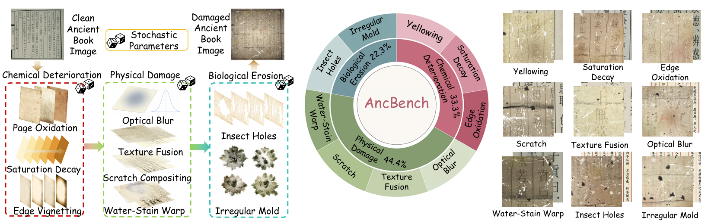
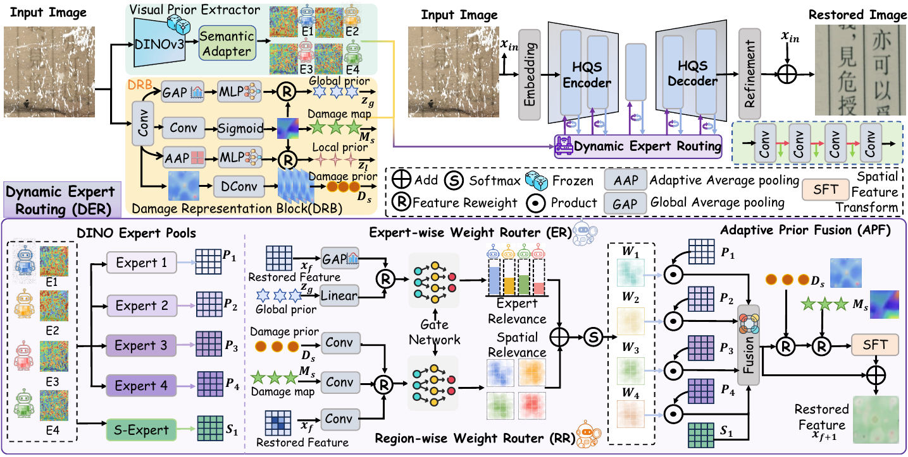

<div align="center">

# Preserving  Cultural Records: A Large-Scale Benchmark and Visual-Prior Routing Network for Ancient Book Image Restoration
</div>

> <!--Learning A Spiking Neural Network for Efficient Image Deraining-->
> 
>  [Shumin Fan](https://scholar.google.com.hk/citations?user=WZv2NgoAAAAJ&hl=zh-CN), [Tianyu Song](https://scholar.google.com/citations?user=wA3Op6cAAAAJ&hl=zh-CN), [Hongming Chen](https://scholar.google.com/citations?user=2DBuqfkAAAAJ), Xiaodong Zhou, [Xiang Chen](https://cschenxiang.github.io/)
>
> Dalian Maritime University, People's Public Security University of China and Nanjing University of Science and Technology
>
> <!--Primary contact: Tianyu Song(songtienyu@163.com)-->
>
> Welcome to visit our website(专注底层视觉领域的信息服务平台) for low-level vision: https://www.lowlevelcv.com
> 
> **Abstract:** 
Ancient books preserve invaluable cultural heritage, yet their images often suffer from complex degradations caused by long-term ageing, environmental exposure, and physical damage. Existing ancient book image restoration benchmarks are limited in scale and rely on simplified degradation simulations, which cannot fully represent real-world degradation patterns and restrict the generalization ability of restoration models. To address these challenges, we introduce AncBench, a large-scale synthetic paired benchmark containing 100K aligned clean-degraded image pairs. AncBench models realistic composite degradations through a comprehensive degradation pipeline that considers material ageing, paper texture variation, blur, staining, water-induced geometric distortion, and local occlusion. Furthermore, we propose AncRestore, a degradation-aware visual-prior routing network for ancient book image restoration. AncRestore first learns degradation representations from degraded images and then dynamically selects and integrates suitable visual priors according to different degradation characteristics. Guided by these degradation cues, a dynamic routing mechanism combines expert-wise and region-wise routing strategies adaptively adjusts the contribution of these priors across different regions, enabling the model to recover both global appearance and local text details. Extensive experiments show that AncRestore effectively suppresses composite degradations while preserving text structures and enhancing restoration quality against other methods, highlighting its application potential for intelligent ancient book image restoration in cultural heritage preservation.
>
> 

# 🔥 Dataset pipeline


# ✨Network  Architecture


<!---->

## News
<!---
- **July 4, 2025:** Paper submitted.
- **Sep 13, 2023:** The basic version is released, including codes, pre-trained models on the Sate 1k dataset, and the used dataset.
- **Sep 14, 2023:** RICE dataset updated.
  ** Sep 15, 2023:** The [visual results on Sate 1K](https://pan.baidu.com/s/1dToHnHI9GVaHQ3-I6OIbpA?pwd=rs1k) and [real-world dataset RSSD300](https://pan.baidu.com/s/1OZUWj8eo6EmP5Rh8DE1mrA?pwd=8ad5) are updated.-->

## Preparation

## 📥Datasets
<table>
<thead>
  <tr>
    <th>Dataset</th>
    <th>AncBench</th>
    <th>HDR28K</th>
    <th>HanInpaint</th>
  </tr>
</thead>
<tbody>
  <tr>
    <td>Baidu Cloud</td>
    <td> <a href="https://pan.baidu.com/s/1sFnPbg21Xi5G7sSOd0FofA?pwd=r9q7 提取码: r9q7">Download</a> </td>
    <td align="center"> <a href="https://pan.baidu.com/s/1El0bUnlYeRmcUS2yFwpWYw?pwd=t4ff 提取码: t4ff">Download</a> </td>
    <td> <a href="https://pan.baidu.com/s/1uP8RkQnrKYjdF7ED6ywkrw?pwd=axhq 提取码: axhq">Download</a> </td>
  </tr>
</tbody>
</table>

### Install

We test the code on PyTorch 1.9.1 + CUDA 11.8 + cuDNN 8.9.6.

1. Create a new conda environment
```
conda create -n AncRestore python=3.8
conda activate AncRestore
```

2. Install dependencies
```
pip install torch==1.9.1+cu118 torchvision==0.10.1+cu118 torchaudio==0.9.1 -f https://download.pytorch.org/whl/torch_stable.html

pip install matplotlib scikit-image opencv-python numpy einops math natsort tqdm lpips time tensorboardX
```

### Download

You can download the pre-trained models and datasets on BaiduPan.

The final file path should be the same as the following:

```
┬─ pretrained_models
│   ├─ Best.pth
│   ├─ ... (model name)
│   └─ ... (exp name)
└─ data
    ├─ HDR28K
    ├─ AncBench
    │├─ train
    ││  ├─ input
    ││  │  └─ ... (image filename)
    ││  │  └─ target
    ││  │  └─ ... (corresponds to the former)
    │└─ test
    │    └─ ...
    └─ ... (dataset name)

```
## 🚨 Notes

1. Send e-mail to songtianyu@dlmu.edu.cn if you have critical issues to be addressed.
2. Please note that there exists the slight gap in the final version due to errors caused by different testing devices and environments. 
3. Because the synthetic dataset is not realistic enough, the trained models may not work well on real world datasets.


<!-- ## 📜 Citation

If you find this work useful, please cite our paper:

```bibtex
@inproceedings{zhang2026scrwkv,
  title={SCRWKV: Ultra-Compact Structure-Calibrated Vision-RWKV for Topological Crack Segmentation},
  author={Zhang, Hanxu and Jia, Chen and Liu, Hui and Cheng, Xu and Shi, Fan and Chen, Shengyong},
  booktitle={Proceedings of the 43rd International Conference on Machine Learning},
  year={2026},
  organization={PMLR}
}
``` -->

<!-- ## 👍 Acknowledgment

This code is based on the [DVANet](https://github.com/leoyjTu/DVANet), [VLU-Net](https://github.com/xianggkl/VLU-Net). Thanks for their awesome work. -->

---

## 🙏 Acknowledgements

This work stands on the shoulders of the following open-source projects, and we sincerely thank their authors for making it possible:

* [DVANet](https://github.com/leoyjTu/DVANet)
* [VLU-Net](https://github.com/xianggkl/VLU-Net)
---